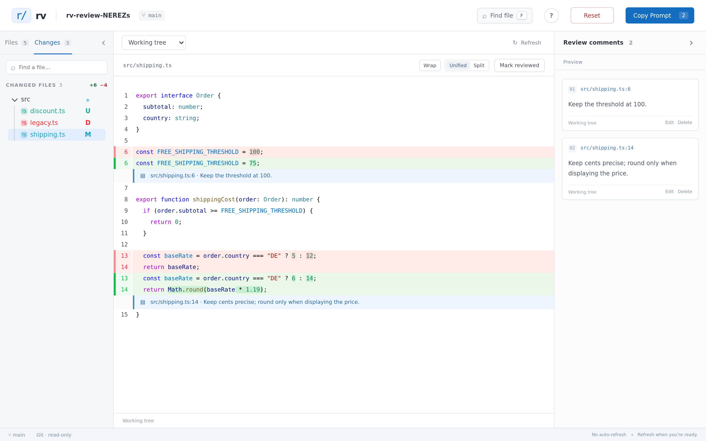
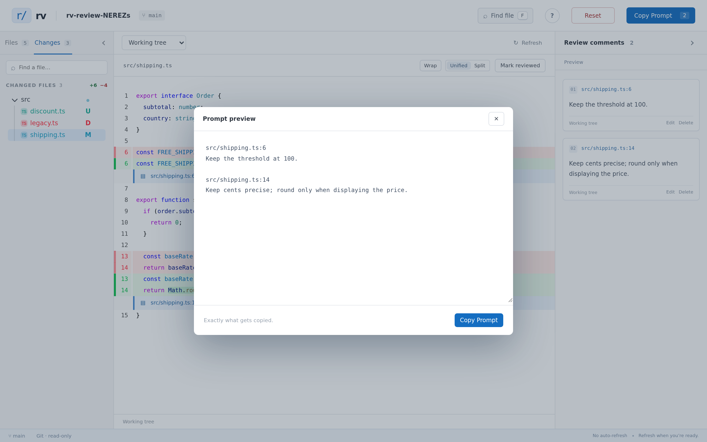

# rv

A small, local code review tool for turning feedback into a prompt for a coding
agent, using [@pierre/diffs](https://diffs.com) and
[@pierre/trees](https://www.npmjs.com/package/@pierre/trees).

There are many tools like this, but this one is customized to my preferences.



## What it does

- Reviews repository files, uncommitted changes, a single commit, or a commit
  range.
- Attaches comments to lines or ranges, plus general comments, and gathers them
  in one place.
- Shows every changed file in one scroll and tracks which ones you have
  reviewed.
- Copies every comment as a concise prompt with exact file and line
  references.
- Is fast and keyboard-driven: file finder, search across files, and a command
  launcher for everything else.
- Runs entirely on your machine: no account, database, telemetry, or
  source-code upload.

## Features

### Pick what to review

The **Review** menu switches between the File Browser (the repository at
HEAD), uncommitted changes, recent commits, and a range of commits. Type a
branch, tag, or hash to review any other revision. Ranges diff from the merge
base, like a GitHub pull request, and a commit's message shows up as a file you
can comment on.


### Every change in one scroll

**Diff** shows every changed file in one scroll: unreviewed files first, under
amber headers, then reviewed files, under lavender headers. The file tree
follows the file at the top as you scroll; selecting a file scrolls to it.
Mark files reviewed from their header, the file tree (also whole directories),
or with <kbd>R</kbd>; <kbd>U</kbd> undoes it.


### Comment on files, lines and ranges

Click **Comment** in a file header for feedback on the whole file. Hover a line
and click **+** for a line comment, or drag **+** to select a range. Line-number
clicks, Shift-click and <kbd>L</kbd> work too. Line comments work on either side
of a diff and appear inline and in the comments panel. Click a comment's text to
edit it. General comments cover feedback that isn't tied to a file.


### Turn comments into a prompt

**Copy Prompt** (<kbd>Y</kbd>) copies every comment as one prompt with exact
file and line references. **Preview** (<kbd>P</kbd>) shows exactly what gets
copied. After copying, rv offers to clear the review or keep the comments for
later.



### Diff, Old, or New

Choose **Diff**, **Old**, or **New** to see the comparison or the complete file
before or after the change. Comments on Old and New use that revision's line
numbers. Diffs can be unified or split (<kbd>V</kbd>), long lines wrap by
default (<kbd>W</kbd>), and **Expand all** shows the unchanged lines between
hunks.


### Find anything

<kbd>F</kbd> opens a fuzzy file finder. <kbd>/</kbd> or
<kbd>⌘</kbd>/<kbd>Ctrl</kbd>+<kbd>F</kbd> searches the viewed file, or
every file in the diff, and highlights each match;
<kbd>⌘</kbd>/<kbd>Ctrl</kbd>+<kbd>G</kbd> jumps to the next one. <kbd>J</kbd>
and <kbd>K</kbd> move between files.


### Keyboard first

Press <kbd>?</kbd> or <kbd>⌘</kbd>+<kbd>K</kbd> to search and run any command
and look up its shortcut.


### Links, tabs, and saved state

Cmd-click (Ctrl-click on Windows/Linux) or middle-click a filename to open it
in a new tab. The URL records the selected file and review scope, including
the revisions for a commit or range, the Diff/Old/New choice (`view=diff`,
`view=old`, or `view=new`), split diffs, and expanded unchanged lines. Copy or
bookmark it to return to that view; browser Back/Forward also works. Each tab
navigates independently. Opening the bare URL starts on uncommitted changes,
or on the most recent commit when there are none (the File Browser only when
neither exists); unsubmitted range choices are temporary and do not survive reload.

Your review state (comments, reviewed marks, layout preferences) is cached on
local disk, outside the repository, in one readable directory per opened path —
`~/.cache/rv/--home-you-repo--/state.json` on Linux,
`~/Library/Caches/rv/--Users-you-repo--/state.json` on macOS. It survives
server restarts, page reloads and browser changes. Use **Clear** to remove
comments and reviewed marks while keeping your view settings.

## Run it

Requires Node.js 22+ and Git.

```sh
npm ci
npm run build
npm link
```

Then run `rv` inside any repository:

```sh
rv
```

rv opens a browser on your uncommitted changes, or on the most recent commit
when the working tree is clean, and serves a read-only review UI on localhost.
Refresh the page (or press <kbd>Shift</kbd>+<kbd>R</kbd>) when you want to
load new repository changes; nothing is written back to the repository.

Open directly on uncommitted changes, a single commit, or a commit range:

```sh
rv --working              # uncommitted changes
rv --commit HEAD          # a single commit
rv --range main..HEAD     # a commit range
```

`--commit` and `--range` accept anything Git understands (branch, tag, short or
full hash). The three options are mutually exclusive.

Use `rv --help` for directory, port, host, and browser options.

### Update

From this repository's checkout, run:

```sh
npm run update
```

This pulls the latest code, installs dependencies, and rebuilds rv. The linked
`rv` command uses the updated build automatically. Restart any running rv servers
when it finishes.

## Development

```sh
npm run build
npm test
npm run test:browser
```
